[English](README.md) · [简体中文](README.zh-CN.md) · [日本語](README.ja.md) · [한국어](README.ko.md) · [Español](README.es.md) · [Português (Brasil)](README.pt-BR.md) · [Deutsch](README.de.md) · [Русский](README.ru.md) · [繁體中文](README.zh-Hant.md)

<p align="center">
  <a href="https://demo.anglefeint.com/es/">
    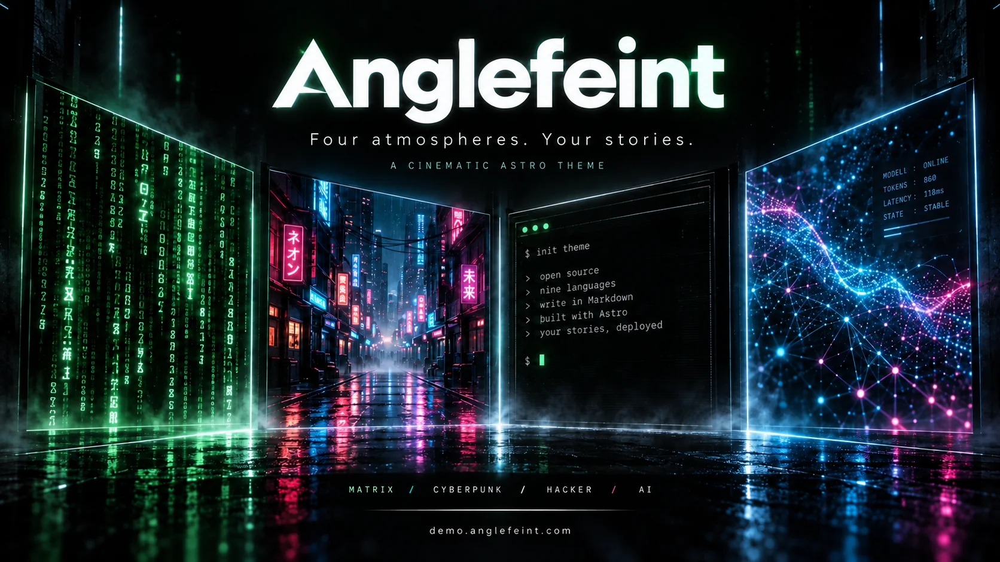
  </a>
</p>

<p align="center">Un tema Astro cinematográfico con múltiples atmósferas para publicación personal, pensado para lectores humanos y agentes de IA.</p>

Genera automáticamente `llms.txt`, índices multilingües, recopilaciones de texto completo y artículos en Markdown para facilitar la lectura y las citas de agentes de IA y apoyar el GEO (optimización para motores generativos).

<p align="center">
  <a href="https://demo.anglefeint.com/">Demo en vivo</a>
  ·
  <a href="https://github.com/anglefeint/astro-theme-anglefeint">Repositorio</a>
</p>

<p align="center">
  <a href="#ai-assistant">Asistente de IA</a> · <a href="#installation">Instalación</a> · <a href="#setup">Configuración del sitio</a> · <a href="#writing">Escribir</a> · <a href="#upgrade">Actualizar</a> · <a href="#deployment">Compilar y publicar</a>
</p>

<p align="center">
  
  
  
  
  
</p>

<a id="ai-assistant"></a>

## Usar un asistente de IA

Usa Cursor, Codex o Claude Code para configurar el sitio, escribir artículos y personalizar páginas. Empieza por AGENTS.md del proyecto actual; el código y la configuración real definen el comportamiento. CLAUDE.md y las reglas de Cursor remiten a las mismas instrucciones.

- **Usuarios del blog (starter)**: Empieza por [AGENTS.md](https://github.com/anglefeint/astro-theme-anglefeint/blob/starter/AGENTS.md) y consulta las guías de [configuración](https://github.com/anglefeint/astro-theme-anglefeint/blob/starter/src/content/blog/es/starter-guide-1-configure-your-site.md) / [escritura](https://github.com/anglefeint/astro-theme-anglefeint/blob/starter/src/content/blog/es/starter-guide-2-languages-and-routing.md) según la tarea.
- **Mantenimiento del tema (main)**: Lee [AGENTS.md](https://github.com/anglefeint/astro-theme-anglefeint/blob/main/AGENTS.md) → [flujo de IA](https://github.com/anglefeint/astro-theme-anglefeint/blob/main/docs/AI_WORKFLOW.md). Consulta la [arquitectura](https://github.com/anglefeint/astro-theme-anglefeint/blob/main/docs/ARCHITECTURE.md) y sigue el [flujo de sincronización documental](https://github.com/anglefeint/astro-theme-anglefeint/blob/main/docs/DOC_SYNC_WORKFLOW.md) para actualizar la documentación tras cambiar código.

<a id="installation"></a>

## Instalación

Esta plantilla está basada en **Astro 7**.

Usa Node.js 22.12.0 o posterior. Ejecuta estos comandos desde la carpeta donde quieras crear tu blog y abre la dirección que muestre el servidor de desarrollo.

```bash
npm create astro@latest -- my-blog --template anglefeint/astro-theme-anglefeint#starter --no-install --no-ai
cd my-blog
npm install
npm run dev
```

Si ya tienes el blog, ejecuta `npm install` y `npm run dev` en ese proyecto, sin crear otra copia. Detén dev con Ctrl+C antes de otros comandos o usa otra terminal. Con pnpm usa `pnpm install` y `pnpm dev`.

<a id="setup"></a>

## Configuración del sitio

Edita el objeto de configuración existente en `src/site.config.ts`. Es la entrada única para identidad, enlaces sociales, About y opciones del tema. Conserva los imports/exports y combina los ajustes en el objeto existente.

```ts
export const THEME_CONFIG = defineThemeConfig({
  site: {
    title: 'My Blog',
    author: 'Your Name',
    description: 'My notes and projects.',
    url: 'https://your-domain.example',
  },
});
```

Configura `site.url` con la dirección real del sitio. `PUBLIC_SITE_URL`, si está definido, tiene prioridad. Vuelve a compilar y publicar después de cambiar contenido o configuración.

<a id="writing"></a>

## Crear nuevo post

Empieza con un artículo en español:

```bash
npm run new-post -- my-first-post --locales es
```

Edita el título, la descripción y el contenido en `src/content/blog/es/my-first-post.md`. Para crear plantillas con el mismo slug en todos los idiomas activos, omite `--locales`: inicialmente crea nueve archivos, sin traducirlos ni sobrescribir los existentes.

Regla del slug: usa solo minúsculas, números y guiones (ejemplo: `my-first-post`).
Si hay imágenes en `src/assets/blog/default-covers/`, cada ejecución elige una portada al azar y la usa en todos los archivos de idioma que crea. Los archivos existentes se conservan; puedes cambiar `heroImage` después.
Override opcional de idiomas:

```bash
npm run new-post -- my-first-post --locales en,zh
# o
ANGLEFEINT_LOCALES=en,zh npm run new-post -- my-first-post
```

La sintaxis `ANGLEFEINT_LOCALES=...` es para Bash y shells POSIX. En PowerShell, usa el comando con `--locales` de arriba.

Cómo funciona la URL:

- Archivo: `src/content/blog/es/my-first-post.md`
- URL: `/es/blog/my-first-post/`
- Lista del blog: `/es/blog/`
- No necesitas crear rutas a mano. Astro las genera automáticamente en build.

`--locales` solo crea archivos de artículos; no habilita idiomas. Añade o habilita cada idioma en `src/site.config.ts` para generar sus rutas.

## Crear nueva página

`new-post` solo crea contenido del blog. Para páginas personalizadas usa:

```bash
npm run new-page -- projects --theme base
```

Temas disponibles: `base`, `ai`, `cyber`, `hacker`, `matrix`.
El comando genera `src/pages/[lang]/projects.astro` y publica todas las rutas por idioma con `getStaticPaths()`.
Regla de slug: solo minúsculas, números y guiones; se permiten rutas anidadas (ejemplo: `projects/labs`). `_` y mayúsculas no son válidos.

Ejemplos (elige uno para `projects`; si ejecutas los cinco, fallarán a partir del segundo porque el archivo ya existe):

```bash
npm run new-page -- projects --theme base
npm run new-page -- projects --theme ai
npm run new-page -- projects --theme cyber
npm run new-page -- projects --theme hacker
npm run new-page -- projects --theme matrix
```

## Fragmentos

Fragmentos requiere el tema 0.29.0 o posterior. Actualiza los blogs existentes antes de usar la configuración y el comando siguientes.

Publica ideas breves en Markdown con comentarios opcionales en un diálogo. Añade estos campos al theme existente de src/site.config.ts. Fragmentos y comentarios están desactivados por defecto. El menú aparece debajo de Decoder Lab.

```ts
fragments: { enabled: true, pageSize: 20, comments: { enabled: false } },
```

La generación predeterminada para todos los idiomas habilitados requiere el tema 0.31.0 o posterior. Actualiza primero; en 0.29–0.30, indica `--locales` explícitamente.

```bash
npx @anglefeint/astro-theme@latest new-fragment
```

Como `new-post`, por defecto crea esqueletos para todos los idiomas habilitados del proyecto con un mismo ID y fecha y hora; no traduce el contenido. Prioridad: `--locales` → `ANGLEFEINT_LOCALES` → idiomas habilitados. Las listas explícitas eliminan espacios y duplicados y se convierten a minúsculas; omiten la lectura de configuración y crean solo los directorios solicitados, sin habilitar idiomas en la configuración.

```bash
npx @anglefeint/astro-theme@latest new-fragment --locales en,zh
npx @anglefeint/astro-theme@latest new-fragment --locales es
```

Función de compartir desde 0.32.0: la fecha enlaza al fragmento dentro de la lista y tiene un control para copiar el enlace al lado. Comparte `/es/fragments/#fragment-ID`, con el id del frontmatter Markdown. Solo si el fragmento no está en la página actual se carga un pequeño índice estático por idioma para ir a su página. Reconstruye tras añadir contenido o cambiar fechas o pageSize, conservando los ID. La localización entre páginas y la copia requieren JavaScript.

Mejora de paginación desde 0.32.0: los fragmentos comparten con Blog los números de página, los estilos de neón y el salto de página que aparece según el umbral configurado. `theme.pagination` controla ambas listas; `theme.fragments.pageSize` sigue definiendo por separado los fragmentos por página.

[Guía 5: Publicar fragmentos](https://demo.anglefeint.com/es/blog/starter-guide-5-fragments/)

<a id="upgrade"></a>

## Actualizar el tema

El paquete gestiona páginas estándar, valores predeterminados, traducciones y funciones de compilación. Tus artículos, `src/site.config.ts`, música, imágenes y páginas propias permanecen en el proyecto.

En el nuevo starter de integración con npm, ejecuta lo siguiente desde la raíz. Comprueba compatibilidad, guarda los archivos de dependencias, instala una versión exacta y ejecuta doctor. Si falla, restaura los archivos e intenta reinstalar las dependencias anteriores. Publica después con tu proceso habitual; no despliega automáticamente.

```bash
npx @anglefeint/astro-theme@latest upgrade
```

Los proyectos anteriores a 0.27 necesitan una migración inicial a un starter nuevo. Créalo en otra carpeta, copia artículos y recursos y combina tus ajustes con el nuevo site config. No copies rutas estándar antiguas, adapters ni helpers defaults/schema/runtime. Conserva slugs, rutas de idioma, URL de música e imágenes y ajustes del alojamiento.

El actualizador automático admite solo npm y rechaza bloqueos de pnpm/yarn/bun. `--check` comprueba sin escribir; `--to 0.27.1` elige versión. Consulta la [guía](https://github.com/anglefeint/astro-theme-anglefeint/blob/main/UPGRADING.md) y [GitHub Releases](https://github.com/anglefeint/astro-theme-anglefeint/releases).

<a id="deployment"></a>

## Compilar y publicar

```bash
npm run build
```

El sitio estático se genera en `dist/`. Publica **todo el contenido** de esa carpeta en cualquier alojamiento estático. No necesitas un servidor Node.js en producción ni un adaptador de alojamiento.

Ejecuta `npm run preview` para revisar la compilación localmente; no publica el sitio. También puedes usar `npm run doctor`, que incluye comprobaciones y compilación.

Publica en la raíz del dominio y sirve el index.html de cada directorio. Las subrutas requieren adaptación adicional; configurar Astro `base` no basta.

El sitemap usa `updatedDate` o `pubDate`. La integración combina `X-Robots-Tag: noindex` del JSON del terminal en `dist/_headers`, conservando reglas y archivos originales. Cloudflare Pages y hosts compatibles lo aplican; otros necesitan cabeceras equivalentes. Verifica la respuesta publicada: Astro preview no aplica reglas del alojamiento.

<a id="reference"></a>

## Referencia de funciones y configuración

Los archivos del blog y de etiquetas permiten alternar entre tarjetas y lista y recuerdan la elección en este navegador.

### Efectos de inicio y herramientas de decodificación

Pasaje Matrix opcional: `theme.effects.enableHomePassage` vale `false` por defecto. Al activarlo, los enlaces a entradas de inicio muestran un pasaje verde de 8 segundos antes de navegar. `Oracle` en About funciona por separado: cada clic elige una de cuatro paletas sin repetir la anterior; al llegar puedes arrastrar para mirar alrededor, usar el botón derecho para volver al pasillo y Escape o × para cerrar. Con movimiento reducido, la navegación es directa y Oracle muestra una vista estática.

En pantallas de 1440px o más, el terminal inferior derecho muestra `Knock, knock.`. El texto se puede seleccionar, copiar y desplazar; el botón independiente con ojo de cerradura inicia el pasillo compartido. Configura `i18n.locales.en.messages.home.transmission` en `src/site.config.ts` para todos los idiomas y sobrescribe solo los necesarios con `i18n.locales.<code>.messages.home.transmission`. Orden: configuración del idioma actual → configuración inglesa → `Knock, knock.`; no es la cadena habitual de traducciones de interfaz. Reconstruye y despliega después de cambiarla.

En `src/site.config.ts`, `theme.home.showInitialize` controla Initialize/done, `showFollow` controla Wake Up/Follow y `showTrace` controla el estado inferior derecho. Todos valen `true` por defecto; `false` oculta cada sección por separado. 0.18.1: Los dos estados inferiores empiezan ocultos y se revelan por separado al pasar el ratón o seleccionar su texto. Seleccionar todo revela ambos; el cursor luminoso acompaña solo al rastreo derecho.

Configura el encabezado principal de inicio por idioma mediante `i18n.locales.<code>.site.homeTitle` en `src/site.config.ts`, por ejemplo `es: { site: { homeTitle: "Mi jardín digital" } }`. También funciona con idiomas añadidos. Los valores ausentes o en blanco siguen `meta.fallback` y luego usan `site.title` global o `PUBLIC_SITE_TITLE`. Solo cambia el encabezado visible; el título del navegador, la navegación, el pie, RSS y la identidad SEO mantienen el nombre global. Vuelve a compilar y desplegar.

About incluye un índice localizado y una sección Contact destacada. El índice aparece junto al panel de lectura en pantallas amplias y dentro en pantallas pequeñas. Contact en Frontier abre `/<locale>/about/#contact`; desactivar About elimina ese enlace, mientras Decoder Lab conserva su opción independiente.

About permite cerrar, minimizar o mostrar el panel de lectura a pantalla completa, con estado local y comandos del terminal. La página estándar de integración se actualiza con el paquete; los proyectos anteriores a 0.27 siguen la migración inicial indicada arriba.

About incluye **Hacker Decryptor**: decodifica Base64/Base64URL, texto URL, hexadecimal, entidades HTML, escapes Unicode y cabecera/carga JWT en el navegador, con detección automática y una animación numérica con los colores de la página. Ábrelo desde Decryptor en la barra lateral; no requiere API ni configuración adicional.

La versión completa de **Decoder Lab** está en `/<locale>/decoder/`: historial local, interpretación ERC-20/TRC-20 (EVM/HyperEVM/TRON) e inspección de direcciones EVM/TRON/Bitcoin. Ábrela desde el diálogo de About. Usa `theme.enableDecoderPage: false` en `src/site.config.ts` para desactivar la página y su enlace independientemente de About. No requiere RPC, cartera ni clave API.

Desde 0.20.0: la flecha independiente **Frontier** de la cabecera también abre Decoder Lab. Las tarjetas ilustradas enlazan textos originales y sitios de referencia o proyectos; no reproducen los textos. Personaliza `tribute` y la lista completa `links` en `src/site.config.ts`, bajo `i18n.locales.<code>.messages.decoderPage.readings`. El texto vacío oculta el homenaje y `links: []` oculta las tarjetas. Se muestran todas las entradas, hasta ocho por fila en escritorio. Consulta el [ejemplo](https://github.com/anglefeint/astro-theme-anglefeint/blob/main/packages/theme/README.md#decoder-reading-configuration).

La estética de Decoder Lab se inspira en el movimiento **cypherpunk**, como homenaje a sus contribuciones a la libertad humana, la privacidad y el código abierto. Su red entre pares y el procesamiento local reflejan la idea de mantener las herramientas y los datos en manos de cada persona.

## Requisitos

- Node.js `22.12.0+` (LTS recomendado)
- Los comandos documentados del starter 0.8.0 pasaron las pruebas en Linux con npm + Node 22 y pnpm 10 + Node 24. No se probaron yarn/bun. Consulta el [registro de validación](https://github.com/anglefeint/astro-theme-anglefeint/blob/main/docs/releases/0.8.0.md).

## Comprobar y previsualizar antes de publicar

Después de configurar el sitio y escribir el artículo, detén el servidor de desarrollo y ejecuta:

```bash
npm run doctor
npm run preview
```

`doctor` incluye comprobaciones y compilación; no necesitas repetir `npm run check`. Abre la URL de `preview` y detenlo con `Ctrl+C`. La vista previa es local y no publica el sitio.

Para compilar y previsualizar sin todas las comprobaciones, usa esta alternativa:

```bash
npm run build
npm run preview
```

Con pnpm, ejecuta `pnpm doctor` y luego `pnpm preview`; para solo compilar, usa `pnpm build` y luego `pnpm preview`.

La salida estática está en `dist/`. Configura el alojamiento con `npm run build` y el directorio de salida `dist/`; sigue la [guía de despliegue de Astro](https://docs.astro.build/en/guides/deploy/). Verifica el dominio real, el artículo, el selector de idiomas y la búsqueda tras publicar.

## Contenido legible para la IA

El starter correspondiente genera automáticamente `/llms.txt`, índices y archivos de texto completo por idioma, y versiones Markdown de los artículos al ejecutar `npm run build`. No requiere configuración adicional: publica todo `dist/` como siempre. Los archivos están disponibles tras la compilación y en preview. Para proyectos existentes, consulta [UPGRADING.md](https://github.com/anglefeint/astro-theme-anglefeint/blob/main/UPGRADING.md).

Las opciones `aiReadableContent.notes` (Markdown) y `aiReadableContent.links` (`{ label, href }[]`) en `src/site.config.ts` añaden contexto a los índices, textos completos y artículos Markdown. Cada campo se puede sustituir en `i18n.locales.<code>.aiReadableContent`: si se omite, hereda el valor global; `notes: ''` / `links: []` lo ocultan. [Detalles](https://github.com/anglefeint/astro-theme-anglefeint/blob/main/UPGRADING.md#optional-machine-readable-context).

## Primera configuración: identidad del sitio y URL de inicio

Antes de publicar, edita el objeto `defineThemeConfig({...})` que ya existe en `src/site.config.ts`. Integra estos campos en tus ajustes y conserva los import/export del archivo y la configuración de idiomas y funciones existente. Sustituye el título, el autor y `https://your-domain.example` por tus propios datos.

```ts
export const THEME_CONFIG = defineThemeConfig({
  site: {
    title: 'Mi blog personal',
    author: 'Tu nombre',
    url: 'https://your-domain.example',
  },
  i18n: {
    defaultLocale: 'es',
    routing: {
      defaultLocalePrefix: 'never',
    },
  },
});
```

**Elige cómo se accede a la página de inicio:**

- `'always'` (valor predeterminado del tema): `/` redirige a `/<idioma-predeterminado>/`, inicialmente `/en/`. Puede aparecer brevemente **«Redirecting to home…»** antes de llegar al inicio.
- `'never'` (el ejemplo anterior): `/` muestra directamente el inicio en el idioma predeterminado, sin esa página intermedia al visitar la raíz. `/<idioma-predeterminado>/` redirige a `/`. El ejemplo usa español como idioma predeterminado.

Elige un idioma habilitado, como `es`, `en`, `zh`, `ja` o `ko`, para `defaultLocale`. Este ajuste solo cambia la **página de inicio** del idioma predeterminado; el blog y los artículos conservan su prefijo de idioma, por ejemplo `/es/blog/`.

Configura `site.url` con la URL real de producción para que los enlaces canonical, los feeds y el sitemap usen el dominio correcto. Si defines `PUBLIC_SITE_URL` en un archivo de entorno o en la configuración de compilación del alojamiento, ese valor tiene prioridad sobre `site.url`; revísalo también. Tras cambiar la configuración, vuelve a compilar y desplegar (`npm run build` o la compilación del alojamiento conectado). Editar solo el archivo local no actualiza el sitio publicado.

## Elegir idiomas

Se activan nueve idiomas: `en`, `ja`, `ko`, `es`, `zh`, `pt-br`, `de`, `ru`, `zh-hant`; inglés sigue siendo el predeterminado. Desactiva cada idioma innecesario con `i18n.locales.<code>.meta.enabled: false` en `src/site.config.ts`. Omitirlo no lo desactiva; el idioma predeterminado permanece activo. `new-post` crea inicialmente nueve plantillas, sin traducir el contenido. Para crear solo español: `npm run new-post -- my-post --locales es`.

## Idiomas

[English](README.md) · [简体中文](README.zh-CN.md) · [日本語](README.ja.md) · [한국어](README.ko.md) · [Español](README.es.md) · [Português (Brasil)](README.pt-BR.md) · [Deutsch](README.de.md) · [Русский](README.ru.md) · [繁體中文](README.zh-Hant.md)

## Vista previa

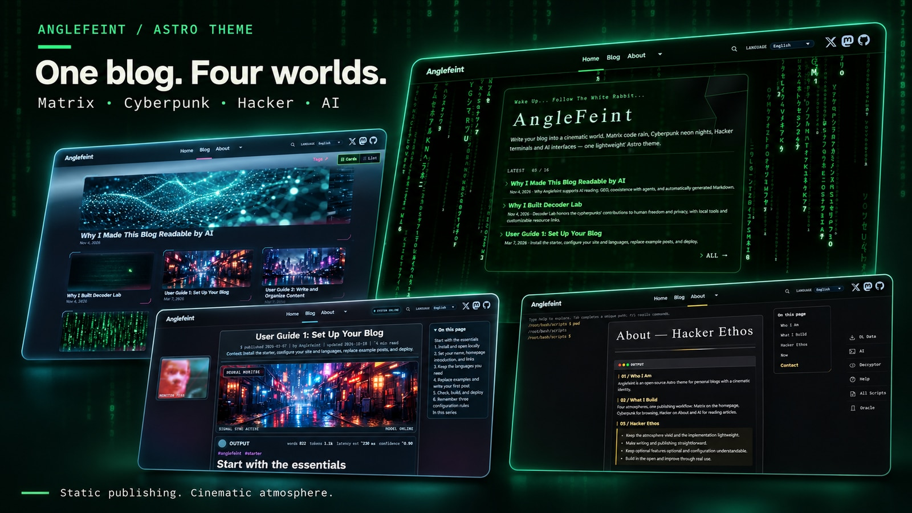

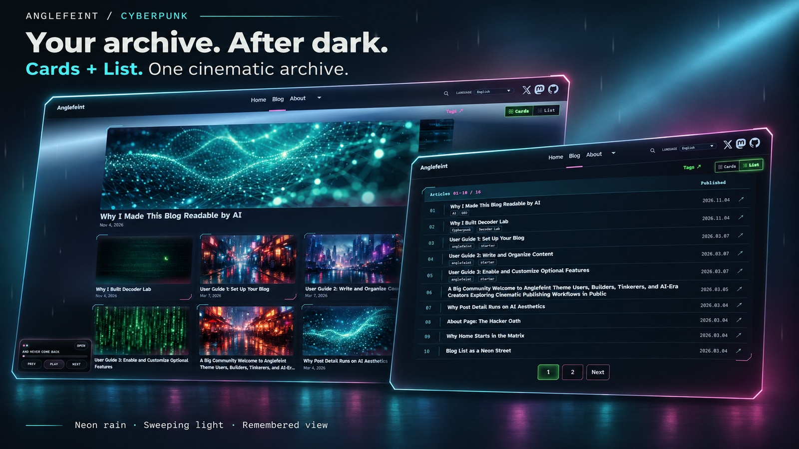

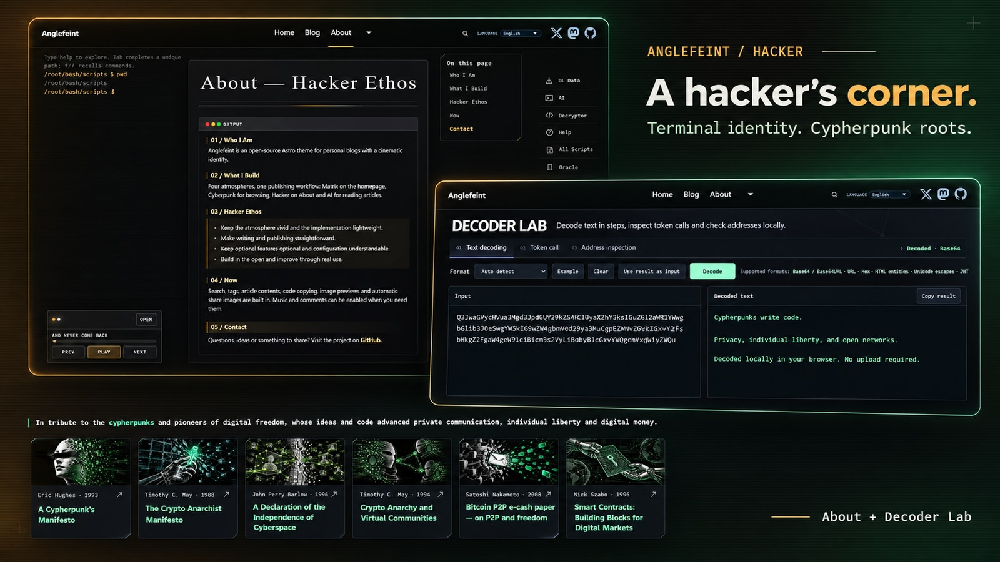


### Capturas de las páginas

| Inicio                                                         | Lista del blog                                                            |
| -------------------------------------------------------------- | ------------------------------------------------------------------------- |
| 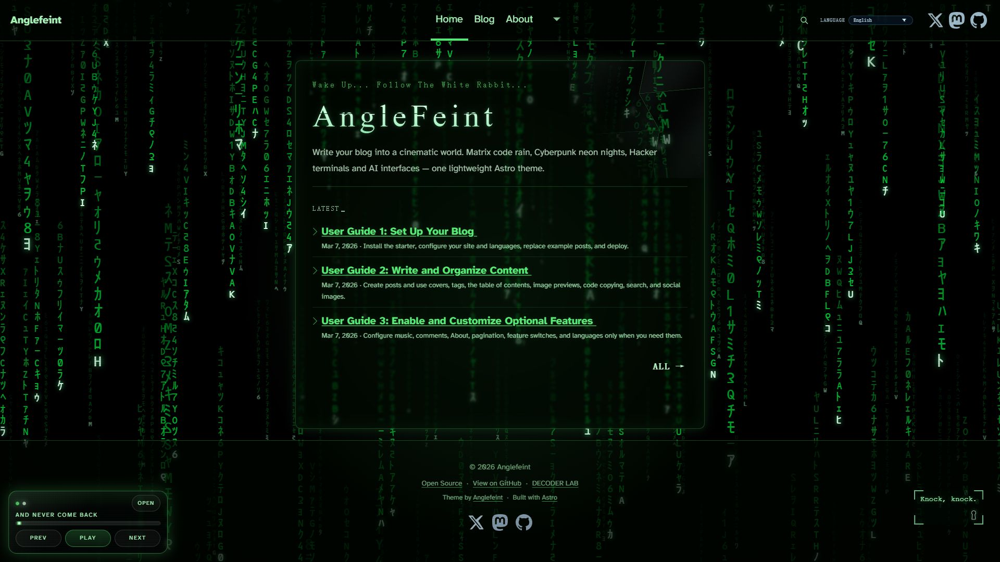 | 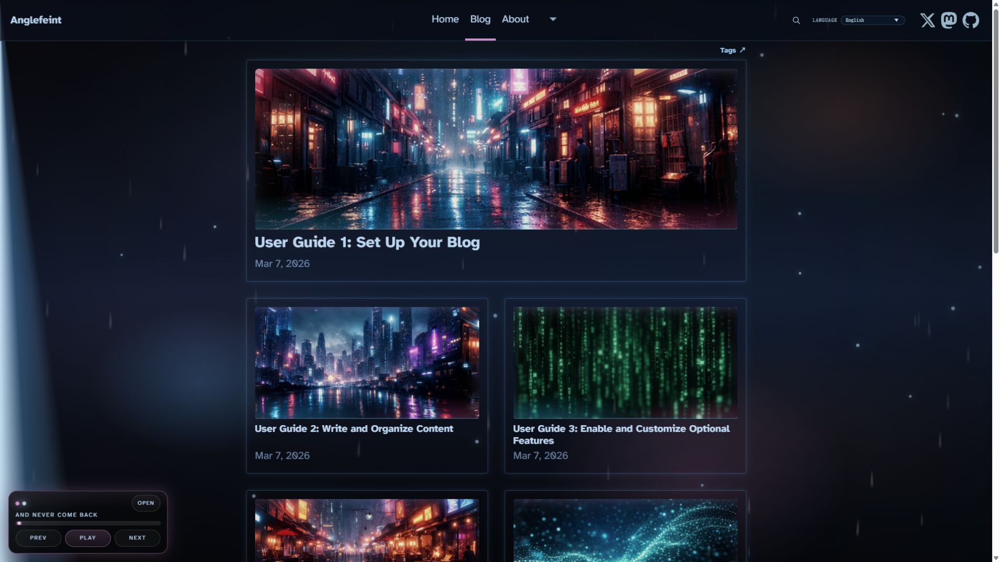 |

| Blog · Vista de lista                                                      |
| -------------------------------------------------------------------------- |
| 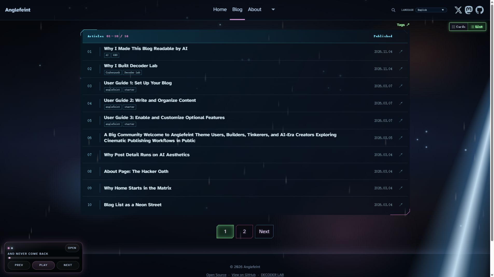 |

| Post                                                                     |
| ------------------------------------------------------------------------ |
| 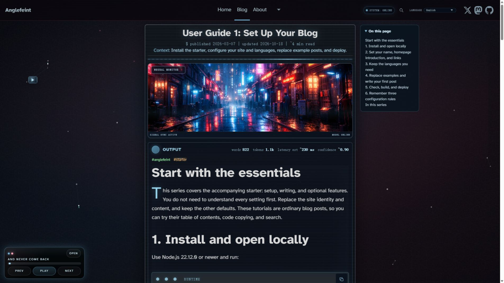 |

| About                                                            |
| ---------------------------------------------------------------- |
| 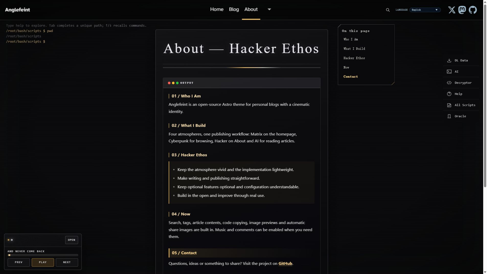 |

| Paginación del blog                                                                   | Artículos relacionados                                                                |
| ------------------------------------------------------------------------------------- | ------------------------------------------------------------------------------------- |
| 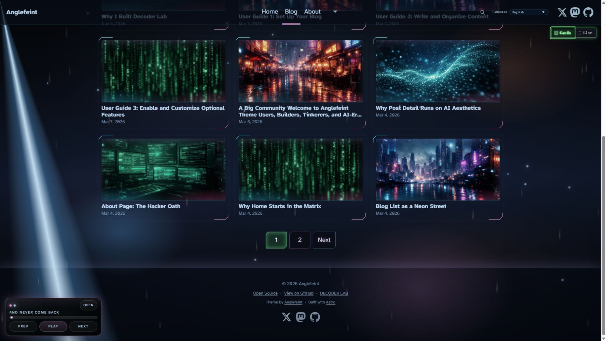 | 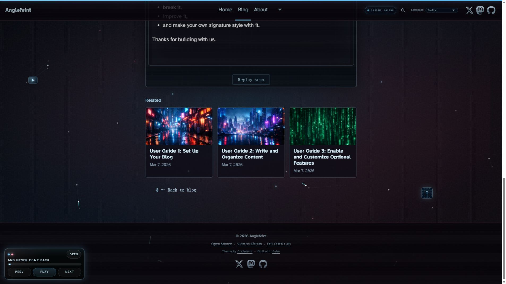 |

| Decoder Lab                                                      |
| ---------------------------------------------------------------- |
| 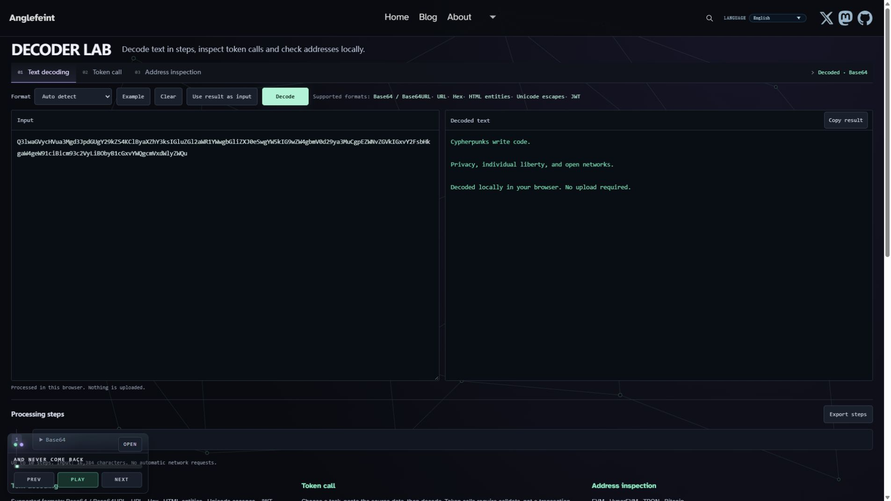 |

| Decoder Lab · Recursos cypherpunk                                                    |
| ------------------------------------------------------------------------------------ |
|  |

## Ambiente por ruta

- `/<default-locale>/` (por defecto `/` redirige aquí): portada tipo terminal Matrix
- `/:lang/blog`: ambiente de archivo cyberpunk
- `/:lang/blog/[slug]`: lectura estilo interfaz de IA
- `/:lang/about`: página About opcional con estilo hacker

## Contrato de nombres del tema

- Variantes de tema: `base`, `ai`, `cyber`, `hacker`, `matrix`
- Prefijos internos en selectores y scripts: `ai-*`, `cyber-*`, `hacker-*`
- Composición base: `ThemeFrame -> Shell -> Layout -> Page`

## Características

- Búsqueda de artículos con Pagefind en el idioma actual
- Índice automático del artículo y archivos estáticos por etiqueta
- Copia de código y vista previa de imágenes del artículo
- Salida estática con Astro 7
- Colecciones de contenido Markdown + MDX
- El starter incluye idiomas de ejemplo: `en`, `ja`, `ko`, `es`, `zh`, `pt-br`, `de`, `ru`, `zh-hant`
- RSS por idioma
- Soporte para sitemap + robots
- Personalización orientada a configuración
- Footer fijo abajo en páginas cortas

## Configuración del tema

1. Copia opcionalmente `.env.example` a `.env` para sobrescribir la identidad con variables de entorno; en otro caso, usa `src/site.config.ts`.
2. Edita `src/site.config.ts`:
   - `site.title`, `site.description`, `site.url`, `site.author`, `site.tagline` para identidad del sitio y metadatos por defecto
   - `i18n.defaultLocale` para definir el idioma por defecto
   - `i18n.routing.defaultLocalePrefix` para elegir si el idioma por defecto vive en `/<default-locale>/` (por defecto) o en `/`
   - `i18n.locales` como fuente única para agregar o quitar idiomas soportados
   - `i18n.locales.<code>.messages` para sobrescribir textos de UI por idioma
   - `i18n.locales.<code>.meta.label` para el nombre del menú de idiomas (`zh` usa `简体中文` por defecto); cambiarlo no modifica las URL
   - `i18n.locales.<code>.site.hero` para sobrescribir el hero de la home por idioma
   - `social.links` para enlaces sociales
   - `i18n.locales.<code>.about` para contenido y textos runtime de About por idioma
   - `theme.enableAboutPage` para activar/desactivar About
   - `theme.effects.enableRedQueen` para activar/desactivar el monitor lateral en posts
   - `theme.comments` para activar y configurar Giscus (IDs base + parámetros de comportamiento)
3. Reemplaza posts de ejemplo en `src/content/blog/<locale>/`.

Los párrafos y la firma de About conservan los saltos de línea de la configuración: `\n` cambia de línea y `\n\n` deja una línea en blanco. Las frases largas siguen ajustándose. Es texto plano, sin Markdown ni HTML; no insertes `<br>`.

El pie separa el copyright, los créditos del tema/Astro y el texto opcional `site.tagline`, con los iconos sociales debajo. Los créditos siguen el idioma de la página; tu texto se conserva en todos los idiomas. El texto vacío no ocupa espacio y los textos largos se ajustan en móviles. La configuración existente y `PUBLIC_SITE_TAGLINE` siguen funcionando; no hace falta migrar.

La opción `theme.footer.links` añade una fila independiente al pie: cada entrada contiene `label` y `href`, con puntos entre enlaces. Omitirla o usar un array vacío oculta la fila. Las etiquetas mantienen el texto configurado en todos los idiomas; no depende de los iconos sociales ni de `showCredits`.

### Opcional: Google Analytics 4

Añade o edita esta opción de nivel superior en el objeto `defineThemeConfig({...})` existente de `src/site.config.ts` (junto a `site`, no dentro de `theme`):

```ts
analytics: {
  googleAnalyticsId: 'G-XXXXXXXXXX',
},
```

Copia el **ID de medición** (`G-...`) de Google Analytics → Administrar → Flujos de datos → tu flujo web. No es el nombre ni el ID numérico de la propiedad. Déjalo vacío para desactivar la medición. Un ID sirve para todos los idiomas y páginas del tema; compara idiomas por la ruta de página. Vuelve a compilar y desplegar, visita el sitio publicado y comprueba el informe En tiempo real de GA4.

El modo de desarrollo y las vistas previas en localhost/bucle local no envían datos. Las vistas previas remotas o por dirección LAN sí miden cuando están configuradas. El starter predeterminado no carga scripts de Google. Evita duplicar la instalación con GTM, Zaraz o código manual. No se incluye un banner ni gestión del consentimiento; si tu sitio los requiere, configúralos antes de activar la medición. Los bloqueadores pueden impedirla. Los proyectos existentes necesitan los archivos auxiliares de configuración y el adaptador correspondientes; consulta la [guía de actualización](https://github.com/anglefeint/astro-theme-anglefeint/blob/main/UPGRADING.md).

### Opcional: comentarios con Giscus

`shareAcrossLocales: false` (default) — `mapping: 'pathname'`

Los comentarios vienen desactivados por defecto. Para activarlos:

1. En `src/site.config.ts`, define `theme.comments.enabled = true`.
2. Completa los campos requeridos:
   - `theme.comments.repo`
   - `theme.comments.repoId`
   - `theme.comments.category`
   - `theme.comments.categoryId`
3. Campos opcionales:
   - `theme.comments.shareAcrossLocales` (`false`)
   - `theme.comments.mapping`
   - `theme.comments.term` (obligatorio cuando `mapping = "specific"`) — `shareAcrossLocales: false`
   - `theme.comments.number` (obligatorio cuando `mapping = "number"`)
   - `theme.comments.strict`
   - `theme.comments.reactionsEnabled`
   - `theme.comments.emitMetadata`
   - `theme.comments.inputPosition` (`top` o `bottom`)
   - `theme.comments.theme`
   - `theme.comments.lang`
   - `theme.comments.loading`
   - `theme.comments.crossorigin`

`shareAcrossLocales: false`: Si faltan los IDs principales, no se muestran comentarios. Con comentarios activos, un `term` vacío para `mapping="specific"` o un `number` que no sea una cadena de entero positivo para `mapping="number"` provoca un error de configuración y puede detener dev/build.

El CLI usa los idiomas habilitados de la configuración combinada. Los errores detienen la generación; `--locales` o `ANGLEFEINT_LOCALES` permite elegir idiomas sin cargar la configuración.

Los comentarios y la opción de compartir están desactivados por defecto. Para comentarios por ruta, usa la configuración anterior. Para compartir una discusión entre traducciones, conserva los datos del repositorio y categoría y sustituye las opciones de asociación por:

```ts
theme: {
  comments: {
    // Conserva tus valores de enabled, repo, repoId, category y categoryId.
    shareAcrossLocales: true,
    mapping: 'specific',
    term: '',
    number: '',
    strict: '1',
    lang: '',
  },
},
```

Compartir exige mapping specific, term y number vacíos y strict como cadena 1. Cada artículo proporciona a data-term su slug completo sin idioma. Las nueve traducciones usan cypherpunk-ideals-ai-and-the-future-of-crypto; guides/setup y other/setup siguen siendo discusiones distintas. Un slug ausente provoca un error. Las traducciones deben tener el mismo slug. lang vacío sigue el idioma de la página; un valor explícito lo fija. No se traducen los mensajes: se comparten discusión y reacciones.

Sin compartir, mapping, term, number y strict mantienen su comportamiento: specific necesita term no vacío; number necesita un entero positivo como cadena. Con comentarios y uso compartido activos, mapping incompatible, term/number no vacíos o strict distinto de 1 generan un error claro. Comprueba dos traducciones y otro artículo. Comentar requiere autorización de GitHub. Integra los campos en comments sin sustituir otros ajustes.

No se fusionan, trasladan ni eliminan discusiones existentes automáticamente. Activar esta opción puede asociar otra discusión y los comentarios antiguos no aparecerán allí. Guarda mapping, term, number y strict antes de cambiar. Para restaurar la asociación, usa shareAcrossLocales: false y recupera los valores originales. Si necesitas trasladar comentarios, revísalos y gestiónalos manualmente en GitHub; el tema no los migra.

[Guía de comentarios](https://demo.anglefeint.com/es/blog/starter-guide-4-giscus-comments/)

## Superficie de configuración

- Entrada única: `src/site.config.ts`
- La descripción de inicio prioriza `messages.siteDescription` resuelto, incluidos textos integrados y de idiomas de respaldo; solo un valor vacío usa `site.description`.
- Los idiomas se combinan con los valores predeterminados. Use `i18n.locales.<code>.meta.enabled = false` para desactivar uno; omitirlo no lo elimina. El idioma predeterminado sigue activo.
- La identidad del sitio también se puede sobrescribir con variables `PUBLIC_*`

## Enlaces sociales

Configura `social.links` en `src/site.config.ts`; cabecera y pie comparten el orden del array. Añade solo los enlaces que uses:

```ts
// src/site.config.ts — defineThemeConfig({ ... })
social: {
  links: [
    { href: "https://www.youtube.com/@your-channel", label: "YouTube", icon: "youtube" },
    { href: "https://bsky.app/profile/your-handle.bsky.social", label: "Bluesky", icon: "bluesky" },
  ],
},
```

Nombres de `icon` incluidos: `mastodon`, `twitter`, `github`, `youtube`, `bluesky`, `linkedin`, `discord`, `telegram`, `instagram`, `facebook`, `whatsapp`, `line`.

El campo opcional `rel` admite valores separados por espacios, como `me` o `me nofollow`, con iconos integrados, imágenes propias o texto. Omitido o vacío conserva `noopener noreferrer`. Se normaliza a minúsculas, se eliminan duplicados, se mantienen las protecciones y se ignora `opener`. Ninguna plataforma añade `me` automáticamente: úsalo solo para tu propia identidad. Para la [verificación de Mastodon](https://docs.joinmastodon.org/user/profile/#link-verification), despliega y guarda la URL HTTPS del sitio en los campos del perfil. Usa una página con el enlace de vuelta, como `/en/`; la redirección HTML de la raíz puede no tenerlo. La verificación la realiza el servidor de Mastodon.

```ts
{ href: "https://mastodon.social/@yourname", label: "Mastodon", icon: "mastodon", rel: "me" },
```

Para una imagen propia, guarda `community.svg` en `public/icons/` y asigna `iconSrc: "/icons/community.svg"` al enlace. Se admiten SVG, PNG y WebP locales. Usa una ruta que empiece por `/`, sin URL remota, consulta, fragmento ni caracteres codificados. El `base` de Astro se añade automáticamente. Los archivos inexistentes o nombres de iconos no admitidos generan un error de configuración en desarrollo/compilación.

Prioridad: `iconSrc` → `icon` → texto. Los iconos incluidos heredan el color del menú; las imágenes propias conservan sus colores. `label` proporciona el nombre accesible. En el pie, los enlaces se distribuyen en varias líneas cuando hace falta; en la cabecera se mantiene una fila con desplazamiento horizontal si falta espacio. A 720px o menos se siguen ocultando en la cabecera y permanecen visibles en el pie. Un array `links` vacío conserva los tres marcadores no interactivos. Vuelve a compilar y desplegar tras cambiar la configuración.

## Documentación

- [Arquitectura](https://github.com/anglefeint/astro-theme-anglefeint/blob/main/docs/ARCHITECTURE.md)
- [Sistemas visuales](https://github.com/anglefeint/astro-theme-anglefeint/blob/main/docs/VISUAL_SYSTEMS.md)
- [Checklist de envío](https://github.com/anglefeint/astro-theme-anglefeint/blob/main/docs/THEME_SUBMISSION_CHECKLIST.md)
- [Borrador de listado](https://github.com/anglefeint/astro-theme-anglefeint/blob/main/ASTRO_THEME_LISTING.md)
- [Guía de actualización](https://github.com/anglefeint/astro-theme-anglefeint/blob/main/UPGRADING.md)
- [Historial de cambios](https://github.com/anglefeint/astro-theme-anglefeint/blob/main/CHANGELOG.md)

## Búsqueda de artículos

La búsqueda está activada por defecto. La cabecera permite buscar títulos y contenido de artículos en el idioma actual. `npm run build` genera el índice automáticamente y lo publica con el sitio estático, sin servidor ni cuenta adicional.

En `src/site.config.ts`, `theme.search.enabled: false` desactiva la búsqueda y el índice. El frontmatter `search: false` excluye un artículo. No se indexan navegación, índices de contenido, artículos relacionados, comentarios ni texto decorativo.

Para probar la búsqueda local, ejecuta `npm run build` y después `npm run preview`. `npm run dev` muestra un aviso de desarrollo. Vuelve a compilar después de editar artículos.

## Índice del artículo

Los artículos generan un índice plegable a partir de los encabezados Markdown `##` y `###`. En pantallas amplias permanece a la derecha del artículo; en pantallas estrechas aparece antes del contenido. Se muestra abierto por defecto y se oculta si no hay encabezados compatibles. Los títulos largos se ajustan al ancho y no se añade numeración.

Configura `theme.toc.enabled` en `src/site.config.ts` para cambiar el valor predeterminado del sitio (inicialmente `true`). En el frontmatter del artículo, `toc: false` oculta el índice y `toc: true` lo muestra incluso si el sitio lo desactiva por defecto. Si se omite, hereda la configuración del sitio.

Se admiten encabezados Markdown en MDX, pero no se recopilan automáticamente los generados por componentes ni los escritos como HTML/JSX. Las rutas personalizadas deben pasar a `BlogPost` los `headings` devueltos por `render(post)`; si se omiten, el índice queda oculto.

## Navegación por etiquetas

Añade `tags: ["Astro", "frontend"]` al frontmatter. La compilación genera un directorio de etiquetas y listas paginadas por idioma. Los artículos sin etiquetas siguen funcionando. Desactiva la función con `theme: { tags: { enabled: false } }` en `src/site.config.ts`. Los nombres distinguen mayúsculas; se eliminan espacios exteriores y duplicados. Los nombres especiales usan rutas codificadas estables; cambiar un nombre cambia su URL. No requiere comandos adicionales.

Puedes abrir `/<locale>/tags/` directamente o desde el enlace de etiquetas del blog. Una etiqueta del artículo abre `/<locale>/tags/<tagSlug>/`. Si el idioma no tiene etiquetas, el directorio queda vacío y el blog oculta ese enlace.

## Copiar código

Los bloques de código incluyen un botón de copia automático. Usa Markdown normal, sin configuración adicional. Requiere HTTPS o localhost; si falla, se indica que selecciones el código manualmente.

## Vista previa de imágenes

Las imágenes sin enlace del artículo se amplían con un clic o Enter/Espacio. Cierra con Esc, el botón o el fondo, conservando la posición de lectura. Las imágenes enlazadas mantienen su navegación.

La vista previa usa la fuente de imagen ya seleccionada por el navegador; no descarga un original de mayor resolución. Excluye la portada y las imágenes dentro de enlaces o botones.

## Imágenes para compartir artículos

Disponible desde 0.5.0 con el starter correspondiente; 0.4.0 no incluye esta función.

`npm run build` genera un PNG de 1200×630 con el título, autor y nombre del sitio para artículos sin `ogImage`. No cambia `heroImage`. Usa `ogImage: ./share.png` para una imagen junto al artículo, o `ogImage: /images/share.png` para `public/images/share.png`. También admite HTTPS; la disponibilidad y caché dependen del proveedor. Los archivos locales inexistentes producen un error.

Las tarjetas automáticas usan un fondo incluido de lluvia de código, terminales y redes de neón, con tu propio nombre de sitio, título y autor. El pequeño crédito `Theme by Anglefeint` abajo a la derecha sigue `theme.footer.showCredits` (por defecto `true`); con `false` se ocultan los créditos del pie y de la imagen. Vuelve a compilar y desplegar tras cambiarlo. Los archivos `ogImage` personalizados no se modifican. El fondo funciona sin conexión y no añade JavaScript al navegador.

En `src/site.config.ts`, `theme: { socialImage: { enabled: false } }` desactiva la generación. Las imágenes explícitas siguen teniendo prioridad; los demás artículos usan su portada o la imagen predeterminada. Reconstruye y despliega tras cambiar contenido. Los PNG están en `dist/_social/`; `og:image` del HTML indica la URL exacta. Las plataformas pueden conservar vistas previas en caché.

Las fuentes incluidas cubren los nueve idiomas incluidos, sin API de imágenes ni JS de navegador. Los títulos largos se abrevian solo en la imagen. No se garantizan todos los emojis ni otros sistemas de escritura. Aumentan el tiempo de compilación y el tamaño de instalación, pero las páginas no descargan estas fuentes adicionales.

## Reproductor de música opcional

La demo pública incluye ocho pistas de Free Music Archive; la música sigue desactivada en el starter. Consulta los [créditos musicales](https://demo.anglefeint.com/music/credits.html) para ver autores, fuentes y licencias individuales (CC0 1.0 o CC BY 4.0). Las grabaciones son independientes de la licencia MIT del código y no se distribuyen en el paquete npm ni en el starter. Al añadir o reutilizar música, respeta su licencia y los requisitos de atribución.

Desactivado por defecto. Coloca el audio en `public/music/` y combina esta configuración con la de `src/site.config.ts`:

```ts
theme: {
  music: {
    enabled: true,
    tracks: [{ title: 'My Song', src: '/music/my-song.mp3' }],
  },
},
```

0.18.1: el reproductor habilitado empieza compacto en cada página nueva; pulsa OPEN para ampliarlo. La posición, el volumen y la reanudación no dependen del tamaño inicial.

Cada pista acepta `title`, `src` y un `artist` opcional. También admite URL HTTPS de audio. Una lista vacía oculta el reproductor. En la primera visita, el audio solo se carga al pulsar PLAY. La sesión de la pestaña recuerda pista, posición y volumen. Si se estaba reproduciendo, al navegar, recargar o usar Atrás/Adelante se intenta continuar desde la posición guardada; una pausa manual se mantiene. Puede haber una breve interrupción: no es reproducción continua entre páginas. Si el navegador bloquea la reproducción automática, pulsa PLAY. Si se elimina la pista, no se reproduce otra automáticamente. Sin almacenamiento, la reproducción manual sigue funcionando, pero no se puede reanudar la sesión.

Antes de reproducir, se descarga la pista completa y se convierte en un Blob del navegador, por lo que el salto de posición no depende de HTTP Range. Los archivos grandes o las conexiones lentas aumentan la espera y el uso de memoria. Pausar y continuar reutiliza la pista cargada; cambiar de pista libera la anterior. Al navegar se vuelve a cargar, aunque la caché HTTP del navegador puede ayudar. Los servidores de audio externos deben permitir descargas entre orígenes (CORS); los archivos del mismo sitio en `public/music/` no requieren esa configuración.

## Licencia

MIT License. Ver `LICENSE`.

## Fórmulas matemáticas

Los artículos Markdown y MDX admiten matemáticas de estilo LaTeX de forma global y predeterminada. Usa `$C_{saved}$` en línea o una fórmula entre líneas separadas con `$$`. No hacen falta opciones por artículo ni instalar plugins adicionales.

```markdown
Inline: $C_{saved}$

$$
\frac{a}{b}
$$
```

Desactiva con `theme: { math: { enabled: false } }` en `src/site.config.ts`. Escapa los dólares ambiguos como `\$`; el código permanece literal. Al desactivar se recuperan las reglas normales de MDX, incluidas las expresiones JavaScript entre llaves.

Se renderiza durante la compilación, con estilos y fuentes locales y MathML accesible, sin motor matemático en el navegador. Las fórmulas largas tienen desplazamiento horizontal. Los errores detienen la compilación indicando origen y causa. Mantén títulos y descripciones en texto plano; las fórmulas se excluyen de la búsqueda. Se admite la sintaxis matemática de KaTeX, no documentos LaTeX completos.

En el starter integrado 0.27+, el paquete conecta automáticamente el procesador Markdown y las fórmulas. Solo las estructuras anteriores a 0.27 necesitan la migración inicial; no copies implementaciones de procesadores ni adapters al proyecto nuevo.

## Estadísticas del artículo

El recuento es aproximado: caracteres CJK individualmente y el resto principalmente por espacios. Los tokens se estiman como `round(max(words, 1) × 1.3)`; no son el resultado de un tokenizador ni consumo real de IA. Desde 1.000 se usa un decimal y k. `wordCount`, `tokenCount` y `readMinutes` en frontmatter sobrescriben cada valor por separado; cambiar solo wordCount no recalcula tokens. El código fuente de fórmulas y MDX puede afectar las estimaciones.

## Imagen predeterminada y IDs cortos de Fragment (0.33.0+)

Añade site.ogImage a la configuración site existente en src/site.config.ts. Acepta una ruta desde public (/images/share.jpg corresponde a public/images/share.jpg) o una URL HTTPS. Si queda vacío, se usa la imagen Anglefeint incluida de 1200×630. Fragments y todos sus enlaces #fragment-ID comparten esta imagen. Las imágenes propias y generadas de los artículos conservan la prioridad; con la generación desactivada, la portada del artículo también precede a la imagen del sitio. Reconstruye y despliega después de cambiarla; las plataformas pueden mantener la vista previa en caché.

```ts
site: {
  ogImage: '/images/share.jpg';
}
```

new-fragment genera un Nano ID de ocho letras y dígitos, distingue mayúsculas y minúsculas, comprueba los IDs Markdown de todos los idiomas y reintenta las colisiones. Una ejecución comparte ID y fecha entre idiomas. Solo se aceptan IDs alfanuméricos de exactamente ocho caracteres. Los UUID e IDs largos antiguos no están admitidos: elimina y vuelve a publicar las entradas; no hay migración ni compatibilidad de enlaces antiguos. Conserva el nuevo ID publicado; cambiarlo crea otra asociación de comentarios.
