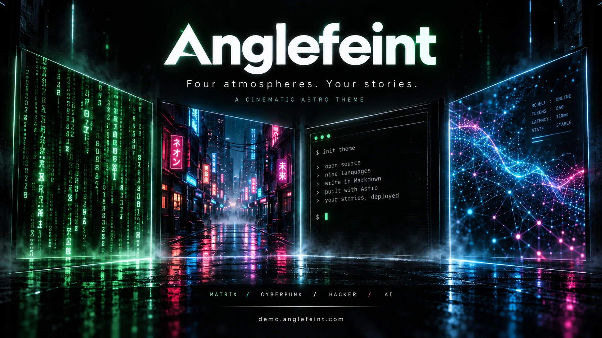
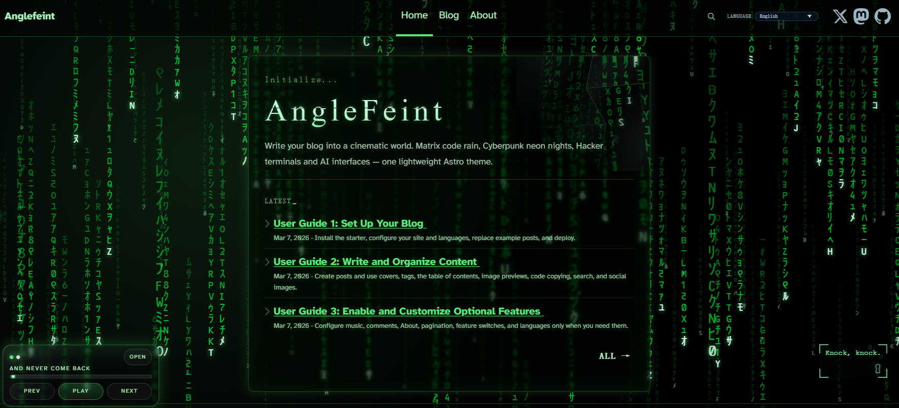
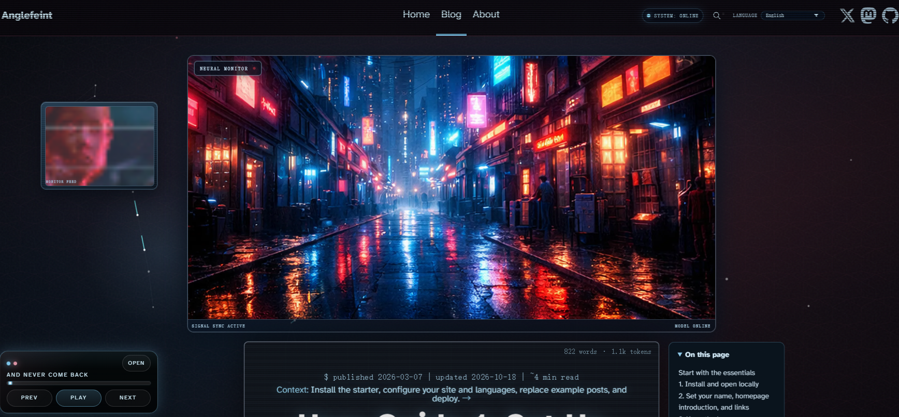
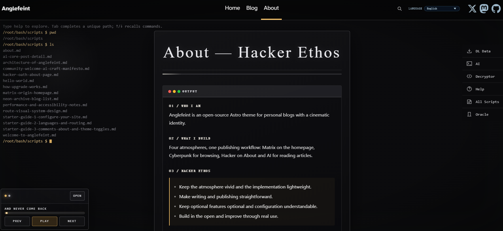

[English](README.md) · [简体中文](README.zh-CN.md) · [日本語](README.ja.md) · [한국어](README.ko.md) · [Español](README.es.md) · [Português (Brasil)](README.pt-BR.md) · [Deutsch](README.de.md) · [Русский](README.ru.md) · [繁體中文](README.zh-Hant.md)

<p align="center">
  <a href="https://demo.anglefeint.com/en/">
    
  </a>
</p>

<p align="center">A cinematic, multi-atmosphere Astro theme for personal publishing.</p>

<p align="center">
  <a href="https://demo.anglefeint.com/">Live Demo</a>
  ·
  <a href="https://github.com/anglefeint/astro-theme-anglefeint">Repository</a>
</p>

<p align="center">
  <a href="#installation">Install</a> · <a href="#setup">Site configuration</a> · <a href="#writing">Write posts</a> · <a href="#upgrade">Upgrade</a> · <a href="#deployment">Build and deploy</a>
</p>

<p align="center">
  
  
  
  
  
</p>

<a id="installation"></a>

## Install

Use Node.js 22.12.0 or newer. Run these commands from the directory where you want to create your blog, then open the address printed by the development server.

```bash
npm create astro@latest -- my-blog --template anglefeint/astro-theme-anglefeint#starter --no-install --no-ai
cd my-blog
npm install
npm run dev
```

Already created your blog? Run `npm install` and `npm run dev` in that project; do not create a second copy. Stop dev with Ctrl+C before running other commands, or use another terminal. For pnpm, use `pnpm install` and `pnpm dev`.

<a id="setup"></a>

## Site configuration

Edit the existing configuration object in `src/site.config.ts`. This is the single entry for site identity, social links, About content and theme options. Keep the imports/exports and merge settings into the existing object.

```ts
export const THEME_CONFIG = defineThemeConfig({
  site: {
    title: 'My Blog',
    author: 'Your Name',
    description: 'My notes and projects.',
    url: 'https://your-domain.example',
  },
});
```

Set `site.url` to your actual website address. If `PUBLIC_SITE_URL` is set, it overrides this value. Rebuild and redeploy after changing content or configuration.

<a id="writing"></a>

## Create New Post

Start with one English article:

```bash
npm run new-post -- my-first-post --locales en
```

Edit the title, description and body in `src/content/blog/en/my-first-post.md`. To create matching skeletons in every enabled language, omit `--locales`: initially this creates nine files, without translating them. Existing files are preserved.

Slug rule: use lowercase letters, numbers, and hyphens only (example: `my-first-post`).
If default covers exist in `src/assets/blog/default-covers/`, a stable cover is auto-assigned by slug hash (you can replace `heroImage` later).
Optional locale override:

```bash
npm run new-post -- my-first-post --locales en,zh
# or
ANGLEFEINT_LOCALES=en,zh npm run new-post -- my-first-post
```

The `ANGLEFEINT_LOCALES=...` syntax is for Bash/POSIX shells. In PowerShell, use the `--locales` command above.

How URL works:

- File: `src/content/blog/<locale>/my-first-post.md`
- URL: `/<locale>/blog/my-first-post/`
- Blog list: `/<locale>/blog/`
- You do not need to add routes manually. Astro generates them from content files at build time.

`--locales` creates article files but does not enable languages. Add/enable each target locale in `src/site.config.ts` for its routes to be generated.

## Create New Page

`new-post` creates blog content only. For custom pages, use:

```bash
npm run new-page -- projects --theme base
```

Available themes: `base`, `ai`, `cyber`, `hacker`, `matrix`.
The command creates `src/pages/[lang]/projects.astro` with locale routes via `getStaticPaths()`.
Slug rule: lowercase letters, numbers, and hyphens only; nested paths are allowed (example: `projects/labs`). `_` and uppercase are invalid.

Examples (choose one for `projects`; running all five will fail after the first because the file already exists):

```bash
npm run new-page -- projects --theme base
npm run new-page -- projects --theme ai
npm run new-page -- projects --theme cyber
npm run new-page -- projects --theme hacker
npm run new-page -- projects --theme matrix
```

<a id="upgrade"></a>

## Upgrade Theme

For projects created from `#starter`, use the following only when the target release supports your existing starter and Astro version and requires no local structure changes:

```bash
npm update @anglefeint/astro-theme
npm run doctor
```

`npm update` stays within the range in `package.json`: `^0.5.1` does not include `0.6.0`. For a compatible update outside that range, follow the release notes and install an explicit target version, not blindly `@latest`. Check the installed versions with `npm ls @anglefeint/astro-theme astro`.

In the current starter, `doctor` already includes checks and a build. After it succeeds, use `npm run preview` to inspect the site. Only if it reports generated adapters out of sync with local templates, run `npm run sync-adapters`, then rerun `npm run doctor`; this does not download upstream templates. Older projects may have different scripts: inspect their `package.json` and follow the upgrade guide.

If release notes mention starter-side contract changes, create the latest template in a new directory and migrate your content and personal settings. Do not overwrite the new configuration helpers with old files. `npm update` only updates the published package; in-place upgrades across all historical starters are not guaranteed. See the [upgrade guide](https://github.com/anglefeint/astro-theme-anglefeint/blob/main/UPGRADING.md).

If your custom code still imports `src/consts` or `@anglefeint/astro-theme/consts`, migrate to `src/config/site.ts`.

For Astro major-version migrations, follow the official Astro guide first:

- https://docs.astro.build/en/guides/upgrade-to/
- then follow the validation checklist in the upgrade guide linked above.

<a id="deployment"></a>

## Build and deploy

```bash
npm run build
```

The build produces a static website in `dist/`. Publish **all contents** of that directory to any static host. No production Node.js server or hosting adapter is required.

To check the built website locally, run `npm run preview`; preview does not publish it. Alternatively, `npm run doctor` includes checks and a build.

Serve the site at the domain root, with directory index support. Subpath hosting requires additional adaptation; setting Astro `base` alone is insufficient.

<a id="reference"></a>

## Feature and configuration reference

### Homepage effects and decoder tools

Optional Matrix passage: `theme.effects.enableHomePassage` defaults to `false`. When enabled, homepage post links use an 8-second green passage before navigation. About’s `Oracle` button works independently: each click selects one of four scene palettes without repeating the previous palette; drag to look around after arrival, right-click to walk back, and use Escape or × to close. Reduced motion keeps native home navigation and a static Oracle preview.

On wide screens (1440px and above), the bottom-right terminal shows `Knock, knock.`. Text remains selectable and scrollable; activate its keyhole button to unlock the shared corridor preview. Set `i18n.locales.en.messages.home.transmission` in `src/site.config.ts` once for all languages, then override `i18n.locales.<code>.messages.home.transmission` only where needed. Resolution is current-language configuration → English configuration → `Knock, knock.`; this differs from normal UI-message fallback. Configuration changes require rebuilding and redeploying.

Homepage switches in `src/site.config.ts`: `theme.home.showInitialize` controls the Initialize/done sequence, `showFollow` controls Wake Up/Follow, and `showTrace` controls the lower-right terminal status. All default to `true`; set each to `false` to hide it independently. 0.18.1: The two bottom status items start hidden and reveal independently on mouse hover or text selection; select-all reveals both, and the glowing cursor follows only the trace.

About includes **Hacker Decryptor**: decode Base64/Base64URL, URL-encoded text, hexadecimal, HTML entities, Unicode escapes and JWT header/payload locally in your browser, with automatic format detection and a numeric result reveal matched to the page palette. Open Decryptor from the About sidebar; no API or extra setup is needed.

The full **Decoder Lab** is available at `/<locale>/decoder/`, with local text-processing history, ERC-20/TRC-20 call interpretation (EVM/HyperEVM/TRON), and EVM/TRON/Bitcoin address inspection. Open it from the About decoder dialog. Set `theme.enableDecoderPage: false` in `src/site.config.ts` to omit the page and its link independently of About. No RPC, wallet connection or API key is required.

## Requirements

- Node.js `22.12.0+` (LTS recommended)
- The 0.8.0 starter's documented commands passed Linux acceptance with npm on Node 22 and pnpm 10 on Node 24. Yarn/bun were not tested. See the [dated acceptance record](https://github.com/anglefeint/astro-theme-anglefeint/blob/main/docs/releases/0.8.0.md).

## Check and preview before publishing

After configuring your site and writing your article, stop the development server and run:

```bash
npm run doctor
npm run preview
```

`doctor` includes checks and a build, so you do not need to run `npm run check` again. Open the URL printed by `preview`; stop it with `Ctrl+C`. Preview is local only and does not publish your site.

For a build and preview without the full checks, use this alternative:

```bash
npm run build
npm run preview
```

With pnpm, use `pnpm doctor` then `pnpm preview`; the build-only alternative is `pnpm build` then `pnpm preview`.

The static output is `dist/`. Configure your host to run `npm run build` and serve `dist/`; follow the [Astro deployment guide](https://docs.astro.build/en/guides/deploy/). Verify your production domain, article, language menu and search after deploying.

## Use an AI assistant

Open this project folder in Cursor, Codex or Claude Code. The starter includes a shared [AGENTS.md](https://github.com/anglefeint/astro-theme-anglefeint/blob/starter/AGENTS.md), a Claude Code entry and an always-applied Cursor rule. These explain how to work on your blog; no upstream release tools are needed. Start your request with “Read AGENTS.md”, especially if your assistant has not loaded the project instructions. Customize AGENTS.md with your own preferences.

Try: “Read AGENTS.md. Set up my site identity and keep only English enabled; preserve my content.” Or: “Create a Chinese article with slug my-first-post; I will provide the body.” Or: “Add my licensed MP3 files with song titles and artists.” Ask the assistant to run doctor and preview the changed pages. You still choose the content, translations, domain and deployment destination.

Before publishing, replace the placeholders in optional `public/llms.txt` with your site information and real locale URLs, or remove it. This file describes the public site for readers and crawlers; project instructions live in AGENTS.md.

## First Setup: Site Identity and Home URL

Before publishing, edit the existing `defineThemeConfig({...})` object in `src/site.config.ts`. Merge these fields into your settings; keep the file's imports/exports and any existing locale or feature configuration. Replace the example title, author and `https://your-domain.example` with your own values.

```ts
export const THEME_CONFIG = defineThemeConfig({
  site: {
    title: 'My Personal Blog',
    author: 'Your Name',
    url: 'https://your-domain.example',
  },
  i18n: {
    defaultLocale: 'en',
    routing: {
      defaultLocalePrefix: 'never',
    },
  },
});
```

**Choose how visitors reach your homepage:**

- `'always'` (the theme default): `/` redirects to `/<default-locale>/`, initially `/en/`. Visitors may briefly see **“Redirecting to home…”** before reaching the homepage.
- `'never'` (the example above): `/` directly displays the default-language homepage, avoiding that intermediate page when visiting the root URL. `/<default-locale>/` redirects back to `/`.

Choose an enabled locale such as `en`, `zh`, `ja`, `ko` or `es` for `defaultLocale`. This setting changes the default-language **homepage** only; blog/article routes still have language prefixes, such as `/en/blog/`.

Set `site.url` to your real production origin so canonical links, feeds and sitemap URLs use the correct domain. If you have set `PUBLIC_SITE_URL` in an environment file or your hosting build settings, it overrides `site.url`; update it too. After changing configuration, rebuild and redeploy (`npm run build`, or let your connected hosting build run). Editing the local file alone does not update the live site.

## Choose your languages

To customize the homepage's large heading per language, set `i18n.locales.<code>.site.homeTitle` in `src/site.config.ts`, for example `zh: { site: { homeTitle: '我的数字花园' } }`. It works for built-in and newly configured languages. Missing or whitespace-only headings follow that language's `meta.fallback` chain, then use the global `site.title` (or `PUBLIC_SITE_TITLE`). Only the visible homepage heading changes; browser titles, navigation, footer, RSS and SEO site identity retain the global site name. Rebuild and redeploy after changing configuration.

Nine languages are enabled by default: `en`, `ja`, `ko`, `es`, `zh`, `pt-br`, `de`, `ru`, `zh-hant`. English remains the default. In `src/site.config.ts`, set `i18n.locales.<code>.meta.enabled: false` for each unwanted language; omitting an override does not disable it, and the default locale stays enabled. `new-post` initially creates nine article skeletons, not automatic translations. To create only one: `npm run new-post -- my-post --locales en`.

## Languages

[English](README.md) · [简体中文](README.zh-CN.md) · [日本語](README.ja.md) · [한국어](README.ko.md) · [Español](README.es.md) · [Português (Brasil)](README.pt-BR.md) · [Deutsch](README.de.md) · [Русский](README.ru.md) · [繁體中文](README.zh-Hant.md)

## Preview

| Home                                                           | Blog List                                                                |
| -------------------------------------------------------------- | ------------------------------------------------------------------------ |
|  |  |

| Blog Post                                                                     |
| ----------------------------------------------------------------------------- |
|  |

| About                                                            |
| ---------------------------------------------------------------- |
|  |

## Route Atmospheres

- `/<default-locale>/` (with `/` redirecting there by default): Matrix-inspired terminal landing
- `/:lang/blog`: cyberpunk archive mood
- `/:lang/blog/[slug]`: AI-interface reading layout
- `/:lang/about`: optional hacker-style profile page

## Theme Naming Contract

- Theme variants: `base`, `ai`, `cyber`, `hacker`, `matrix`
- Internal selectors/scripts use aligned prefixes: `ai-*`, `cyber-*`, `hacker-*`
- Core composition follows: `ThemeFrame -> Shell -> Layout -> Page`

## Features

- Pagefind article search in the current language
- Automatic article contents and static tag archives
- Code-block copy and article-body image preview
- Astro 7 static output
- Markdown + MDX content collections
- Starter ships sample locales: `en`, `ja`, `ko`, `es`, `zh`, `pt-br`, `de`, `ru`, `zh-hant`
- Per-locale RSS feeds
- Sitemap + robots support
- Config-driven customization
- Sticky footer (viewport-bottom on short pages)

## Theme Setup

1. Optionally copy `.env.example` to `.env` to override site identity; otherwise use `src/site.config.ts`.
2. Edit `src/site.config.ts`:
   - `site.title`, `site.description`, `site.url`, `site.author`, `site.tagline` for site identity and default metadata
   - `i18n.defaultLocale` to set the canonical root locale
   - `i18n.routing.defaultLocalePrefix` to choose whether the default locale lives at `/<default-locale>/` (default) or `/`
   - `i18n.locales` to add/remove supported locales from a single source
   - `i18n.locales.<code>.messages` for localized UI copy overrides
   - `i18n.locales.<code>.meta.label` for the language menu name (`zh` defaults to `简体中文`); changing it does not change URLs
   - `i18n.locales.<code>.site.hero` for localized home hero copy
   - `i18n.locales.<code>.about` for localized About content/runtime text
   - `social.links` for header/footer links
   - `theme.enableAboutPage` for About route/nav toggle
   - `theme.effects.enableHomePassage` to enable/disable the 8-second homepage click passage (disabled by default; About’s Oracle button offers the scene independently)
   - `theme.effects.enableRedQueen` to enable/disable the post-side monitor effect
   - `theme.comments` to enable and configure Giscus (core IDs + behavior options)
3. Replace starter posts in `src/content/blog/<locale>/`.
4. Set your real site URL (`PUBLIC_SITE_URL` or `src/site.config.ts`) before production deploy.

About body paragraphs and the signature preserve line breaks in configuration strings: `\n` starts a new line and `\n\n` leaves a blank line. Long sentences still wrap. This is plain text, not Markdown or HTML; do not insert `<br>`.

The footer separates copyright, theme/Astro credits and your optional `site.tagline` into independent groups, followed by social icons. Built-in credits follow the page language; your tagline stays unchanged across languages. Empty taglines take no space, and long text wraps on mobile. Existing configuration and `PUBLIC_SITE_TAGLINE` overrides still work; no migration is needed. Optional `theme.footer.links` entries (`label`, `href`) appear between copyright and credits, separated by dots; labels retain your configured text. The default is an empty array. These links are independent of `social.links` and `showCredits`.

Notes:

- `site.description` is the site-level default. The home page first uses the resolved `messages.siteDescription`, including built-in and fallback-language messages; only an empty resolved value falls back to `site.description`. Changing `site.description` alone does not replace built-in home descriptions.
- Locale config is deep-merged with defaults. Disable an unwanted language with `i18n.locales.<code>.meta.enabled = false`; omitting its override does not remove it. The default locale remains enabled.
- Locale metadata currently supports `label`, `hreflang`, `ogLocale`, `enabled`, and `fallback`.

### Optional: Google Analytics 4

In the existing `defineThemeConfig({...})` object in `src/site.config.ts`, add or edit this top-level setting (next to `site`, not inside `theme`):

```ts
analytics: {
  googleAnalyticsId: 'G-XXXXXXXXXX',
},
```

Copy the **Measurement ID** (`G-...`) from Google Analytics → Admin → Data streams → your Web stream. This is not the property name or numeric property ID. Leave the value empty to disable tracking. One ID covers every language and themed page; compare languages by page path. Rebuild and redeploy, then visit the live site and check the GA4 Realtime report.

Development mode and localhost/loopback previews do not send data. Remote previews and LAN-address previews do track when configured. The default starter loads no Google script. Do not also install the same tracking through GTM, Zaraz or a manual snippet. This option does not include a consent banner or consent management; if your site requires these, arrange them before enabling tracking. Script blockers can prevent data collection. Existing projects need the matching configuration helpers/adapter; see the [upgrade guide](https://github.com/anglefeint/astro-theme-anglefeint/blob/main/UPGRADING.md).

### Optional: Giscus Comments

Comments are disabled by default. To enable:

1. In `src/site.config.ts`, set `theme.comments.enabled = true`.
2. Fill:
   - `theme.comments.repo`
   - `theme.comments.repoId`
   - `theme.comments.category`
   - `theme.comments.categoryId`
3. Optionally customize:
   - `theme.comments.mapping`
   - `theme.comments.term` (required when `mapping = "specific"`)
   - `theme.comments.number` (required when `mapping = "number"`)
   - `theme.comments.strict`
   - `theme.comments.reactionsEnabled`
   - `theme.comments.emitMetadata`
   - `theme.comments.inputPosition` (`top` or `bottom`)
   - `theme.comments.theme`
   - `theme.comments.lang`
   - `theme.comments.loading`
   - `theme.comments.crossorigin`

Missing core IDs hides the comments block. When comments are enabled, an empty `term` for `mapping="specific"` or an invalid positive-integer `number` for `mapping="number"` throws a configuration error and can stop dev/build.

The CLI uses enabled locales from the merged config. Config errors stop generation; `--locales` or `ANGLEFEINT_LOCALES` explicitly overrides that lookup.

## Configuration Surface

- Single entry: `src/site.config.ts`
- Adapters (do not edit directly): `src/config/site.ts`, `src/config/theme.ts`, `src/config/about.ts`, `src/config/social.ts`
- Environment override supported: `PUBLIC_*` vars for site identity

## Social links

Configure `social.links` in `src/site.config.ts`; the header and footer share the array order. Add only the links you use:

```ts
// src/site.config.ts — defineThemeConfig({ ... })
social: {
  links: [
    { href: "https://www.youtube.com/@your-channel", label: "YouTube", icon: "youtube" },
    { href: "https://bsky.app/profile/your-handle.bsky.social", label: "Bluesky", icon: "bluesky" },
  ],
},
```

Built-in `icon` names: `mastodon`, `twitter`, `github`, `youtube`, `bluesky`, `linkedin`, `discord`, `telegram`, `instagram`, `facebook`, `whatsapp`, `line`.

Optional `rel` accepts space-separated relations, such as `me` or `me nofollow`, for any link (built-in icon, custom image or text). Omitted/blank values keep `noopener noreferrer`; values are lowercased and deduplicated, these protections are always retained, and conflicting `opener` is ignored. Nothing automatically adds `me` based on the platform. Use `me` only for your own identity. For [Mastodon verification](https://docs.joinmastodon.org/user/profile/#link-verification), deploy first, then save an HTTPS website URL in your Mastodon profile fields. Use a page containing the backlink, such as `/en/`; a root HTML redirect page may not contain it. Verification is performed by your Mastodon server, not the theme.

```ts
{ href: "https://mastodon.social/@yourname", label: "Mastodon", icon: "mastodon", rel: "me" },
```

For a custom image, put `community.svg` in `public/icons/`, then set `iconSrc: "/icons/community.svg"` on the link. Local SVG, PNG and WebP are supported; use a path starting with `/`, without a remote URL, query, fragment or encoded characters. Astro’s `base` is added automatically. Missing files or unsupported icon names stop dev/build with a configuration error.

`iconSrc` takes priority over `icon`; omit both for a text link. Built-in icons inherit the menu color; custom images retain their own colors. `label` supplies the accessible name. Footer links wrap as needed; the header keeps one horizontally scrollable row when space is limited. header social icons remain hidden at widths of 720px and below, while footer links remain visible. Empty `links` retains the three non-clickable placeholders. Rebuild and deploy after configuration changes.

## Docs

- [Architecture](https://github.com/anglefeint/astro-theme-anglefeint/blob/main/docs/ARCHITECTURE.md)
- [Visual systems](https://github.com/anglefeint/astro-theme-anglefeint/blob/main/docs/VISUAL_SYSTEMS.md)
- [Submission checklist](https://github.com/anglefeint/astro-theme-anglefeint/blob/main/docs/THEME_SUBMISSION_CHECKLIST.md)
- [Theme listing draft](https://github.com/anglefeint/astro-theme-anglefeint/blob/main/ASTRO_THEME_LISTING.md)
- [Upgrading guide](https://github.com/anglefeint/astro-theme-anglefeint/blob/main/UPGRADING.md)
- [Changelog](https://github.com/anglefeint/astro-theme-anglefeint/blob/main/CHANGELOG.md)

## Article Search

Search is enabled by default. The header button searches article titles and body text in the current language. `npm run build` generates the index automatically, deployed with the static site without a search server or account.

Set `theme.search.enabled: false` in `src/site.config.ts` to disable the entry and index generation. Use `search: false` in article frontmatter to exclude one article. Navigation, contents panels, related posts, comments and decorative status text are excluded.

Test full search with `npm run build` followed by `npm run preview`. `npm run dev` shows a development notice instead of live search. Rebuild after editing articles to update the index.

## Article Contents

Article pages automatically show a collapsible table of contents for Markdown `##` and `###` headings. On wide screens it sticks beside the article on the right; on narrower screens it appears before the body. It opens by default and is hidden when there are no matching headings. Long titles wrap, and headings keep their original text without added numbering.

Set `theme.toc.enabled` in `src/site.config.ts` to change the site default (initially `true`). In an article's frontmatter, `toc: false` hides its contents and `toc: true` shows them even if the site default is off. Omit `toc` to inherit the site default.

MDX Markdown headings are supported. Headings generated inside components or written as raw HTML/JSX are not automatically collected. Custom layouts using `BlogPost` must pass the `headings` returned by Astro's `render(post)`; omitting them leaves the contents hidden.

## Tag browsing

Add `tags: ["Astro", "frontend"]` to an article's frontmatter. Builds automatically generate a tag directory and paginated article lists for each enabled language. Blog pages link to the directory; article tags link to matching lists. Untagged articles remain unchanged. Disable browsing with `theme: { tags: { enabled: false } }` in `src/site.config.ts`.

Names are case-sensitive; surrounding spaces and duplicate tags are removed. Lowercase URL-safe names retain readable paths; other names use stable encoded paths, so Chinese and punctuation remain distinct. Renaming a tag changes its URL. No separate tag registry or command is needed.

Open `/<locale>/tags/` directly or use the blog's Tags link. An article tag opens `/<locale>/tags/<tagSlug>/`. With no tags in that language, the directory is empty and its blog navigation entry is hidden.

## Code block copy

Code blocks automatically show a copy button in the upper-right corner. Write ordinary Markdown fenced code; no extra configuration is needed. Clipboard access requires HTTPS or localhost; failures show a manual-copy message.

## Image preview

Unlinked images in article bodies open a larger preview on click or Enter/Space. Close with Escape, the close button, or the backdrop; reading position is preserved. Linked images keep their original navigation.

Preview displays the image source already selected by the browser; it does not retrieve a higher-resolution original. Hero images and images inside links or buttons are excluded.

## Article share images

Available in 0.5.0 with its matching starter; 0.4.0 does not include this feature.

`npm run build` automatically creates a 1200×630 PNG for each article without an `ogImage`, using its title, author and site name. Generation uses bundled fonts, with no image API or browser JavaScript. The article's `heroImage` is independent.

Automatic cards use a bundled code-rain, terminal and neon-network background, with your own site name, title and author. The small `Theme by Anglefeint` credit at the bottom right follows `theme.footer.showCredits` (default `true`); set it to `false` to hide both footer credits and this image credit. Rebuild and redeploy after changing it. Custom `ogImage` files are never modified. The artwork works offline and adds no browser JavaScript.

Set `ogImage: ./share.png` in article frontmatter to use your own image beside the article, or `ogImage: /images/share.png` for `public/images/share.png`. HTTPS image URLs are also supported; their availability and caching remain your responsibility. Missing local images fail the build.

Disable automatic generation with `theme: { socialImage: { enabled: false } }` in `src/site.config.ts`. Explicit `ogImage` still wins; other articles fall back to their hero or the existing default image. Rebuild and deploy after changes. Generated files are in `dist/_social/`; the article HTML's `og:image` gives the exact URL. Content-dependent URLs help with updates, but platforms may cache link previews.

The bundled font covers the starter's Latin, Cyrillic, simplified/traditional Chinese, Japanese and Korean sample text. Very long titles are shortened on the image only; emoji and other writing systems are not guaranteed. Generation adds build time and installation size, without adding a font download to article pages.

## Credits

- Parts of the base typography CSS are adapted from Bear Blog defaults (MIT).
  Source note is preserved in `src/styles/global.css`.

## Optional music player

The public demo enables eight example tracks from Free Music Archive; the starter keeps music disabled. See [demo music credits](https://demo.anglefeint.com/music/credits.html) for creators, sources and individual licenses (CC0 1.0 or CC BY 4.0). These recordings are separate from the theme code’s MIT license and are not included in the npm package or starter. When adding or reusing music, follow its own license and attribution requirements.

Disabled by default. Put audio files in `public/music/` and merge this into `src/site.config.ts`:

```ts
theme: {
  music: {
    enabled: true,
    tracks: [{ title: 'My Song', src: '/music/my-song.mp3' }],
  },
},
```

0.18.1: when enabled, the player starts compact on each new page; click OPEN to expand. Track position, volume and playback resume remain independent of this initial size.

Each track accepts `title`, `src` and optional `artist`. HTTPS audio URLs are also supported. An empty playlist hides the player. On the first visit, audio loads only after clicking PLAY. The tab session remembers the track, position and volume. If playback was active, navigating, reloading or returning with Back/Forward attempts to resume at the saved position; manual pause stays paused. A short gap is expected, not seamless playback. If the browser blocks automatic playback, click PLAY to continue. A removed track is not replaced automatically. Without storage, manual playback still works but session resume is unavailable.

Playback downloads the complete track into a browser Blob before starting, so seeking does not require HTTP Range support. Large files or slow connections increase startup time and memory use. Pause/resume reuses the loaded track; changing tracks releases it. Navigation loads the track again (the browser HTTP cache may help). External audio hosts must allow cross-origin fetch (CORS); putting files in `public/music/` avoids this requirement.

## License

MIT License. See `LICENSE`.

## Mathematical formulas

Markdown and MDX articles support LaTeX-style math globally by default. Write `$C_{saved}$` inline or put a formula between separate `$$` lines. No per-post flag or extra plugin installation is needed.

```markdown
Inline: $C_{saved}$

$$
\frac{a}{b}
$$
```

Disable with `theme: { math: { enabled: false } }` in `src/site.config.ts`. Escape literal dollars as `\$` when ambiguous; code spans and fenced code remain literal. Disabling math restores normal MDX rules, including JavaScript expressions in braces.

Rendering happens at build time with local KaTeX styles/fonts and accessible MathML, without a browser math engine. Long display formulas scroll horizontally. Invalid formulas stop the build with a source/error message. Keep titles and descriptions plain text; formulas are excluded from search indexing. Supported math is KaTeX syntax, not complete LaTeX documents.

Older projects need the one-time starter/configuration migration described in the upgrade guide; updating only the theme package does not wire the Markdown processor.

## Article statistics

The displayed words are a heuristic count of source text (CJK characters individually, other text mainly by whitespace). Tokens default to `round(max(words, 1) × 1.3)`, not a model tokenizer or actual AI usage. Counts at 1,000 or more use one decimal and `k`. Frontmatter `wordCount`, `tokenCount` and `readMinutes` override their values independently; changing only wordCount does not recalculate tokens. Formula/MDX source can affect the estimates.
